# ĐẶC TẢ HỆ THỐNG ĐỊNH TUYẾN (ROUTING SPECIFICATION - ROUTES.MD)

**Dự án:** Huế Cung Đình – Dịch vụ Cưới & Chụp ảnh (`doan-fenc`)  
**Học phần:** Web FrontEnd Nâng Cao (Mã môn: INT.7.18)  
**Sinh viên thực hiện:** Trần Công Quý (MSSV: 2401ITA001 - Lớp CNTT K22)  
**Giảng viên hướng dẫn:** Thầy Dương Ngọc Duy  
**Thư viện:** React Router v8 (`^8.4.0`) + Code Splitting (`React.lazy` & `<Suspense>`)  
**Quy chuẩn Import:**
- `react-router`: `createBrowserRouter`, `useNavigate`, `useLocation`, `useParams`, `useSearchParams`, `Outlet`, `Navigate`, `Link`, `NavLink`.
- `react-router/dom`: `RouterProvider`.

---

## 1. SƠ ĐỒ ĐỊNH TUYẾN TỔNG THỂ (ROUTING DIAGRAM)

```mermaid
flowchart TD
    Root["RouterProvider"] --> MainShell["/ (RootLayout)"]
    Root --> AdminShell["/admin (ProtectedRoute admin + AdminLayout)"]

    MainShell --> PublicGroup["Nhóm Công Khai (Public)"]
    MainShell --> UserGroup["Nhóm Khách Đã Đăng Nhập (user / admin)"]
    MainShell --> SopGroup["Cẩm Nang SOP (/quy-trinh - chỉ admin)"]
    MainShell --> NotFound["* (NotFoundPage 404)"]

    PublicGroup --> P1["/ (HomePage)"]
    PublicGroup --> P2["/dich-vu, /goi-cuoi, /thiep-cuoi, /tu-van"]
    PublicGroup --> P3["/ban-do-di-san, /phoi-co-phuc, /trien-lam"]
    PublicGroup --> P4["/thiep-cuoi/moi/:slug (Thiệp Khách Mời & RSVP)"]
    PublicGroup --> P5["/login (LoginPage)"]

    UserGroup --> U1["/dich-vu/:id, /goi-cuoi/:id, /thiep-cuoi/:id"]
    UserGroup --> U2["/thiep-cuoi/dang-ky & /thiep-cuoi/tuy-bien"]
    UserGroup --> U3["/dat-lich, /ke-hoach-cuoi, /gio-hang, /don-cua-toi"]

    AdminShell --> A1["/admin (AdminDashboardPage)"]
    AdminShell --> A2["/admin/dich-vu & /admin/goi-cuoi"]
    AdminShell --> A3["/admin/thiep-cuoi (Kho Thiệp & RSVP)"]
    AdminShell --> A4["/admin/yeu-cau (Kanban 5 Cột & CSKH)"]
    AdminShell --> A5["/admin/lich-chup (Lịch Điều Phối Ekip)"]
    AdminShell --> A6["/admin/tai-khoan (Quản Lý Tài Khoản)"]
```

---

## 2. MA TRẬN PHÂN QUYỀN 29 KHAI BÁO TUYẾN ĐƯỜNG (28 TUYẾN CHỨC NĂNG + 1 ALIAS)

Hệ thống thiết lập **Phân Quyền 2 Cấp Độ (2-Tier RBAC)** kết hợp phân tách quyền khách vãng lai:
- **`admin` (Quản Trị Viên):** Toàn quyền truy cập toàn bộ 29 khai báo tuyến đường, độc quyền khu vực `/admin/*` và cẩm nang nội bộ `/quy-trinh`.
- **`user` (Khách Hàng Đã Đăng Nhập):** Truy cập các tuyến công khai và toàn bộ các tuyến nghiệp vụ cá nhân (chi tiết dịch vụ/gói/thiệp, phát hành thiệp cưới, đặt lịch kiểm tra ekip, sổ tay kế hoạch cưới, giỏ hàng VietQR, quản lý đơn & in hợp đồng A4).
- **Khách Vãng Lai (Chưa Đăng Nhập):** Truy cập tự do các trang khám phá công khai (`/`, `/dich-vu`, `/goi-cuoi`, `/thiep-cuoi`, `/tu-van`, `/ban-do-di-san`, `/phoi-co-phuc`, `/trien-lam`) và mở đường dẫn thiệp mời đám cưới `/thiep-cuoi/moi/:slug` để gửi lời chúc & xác nhận tham dự RSVP.

| STT | Đường dẫn (Path) | Tên Component | Tải Gói | Quyền hạn | Layout | Tính năng chính & Nghiệp vụ cốt lõi |
| :-: | :--------------- | :------------ | :-----: | :-------: | :----- | :---------------------------------- |
| 1 | `/` | `HomePage` | Eager | Public | `RootLayout` | Hero banner xoay khẩu hiệu, Không gian tương tác Hoàng Triều, Marquee gói cưới, cảm nhận khách hàng |
| 2 | `/dich-vu` | `ServicesPage` | Eager | Public | `RootLayout` | Danh mục 18 dịch vụ lẻ, tìm kiếm tiếng Việt, lọc danh mục, sắp xếp giá, lưu yêu thích |
| 3 | `/dich-vu/:id` | `ServiceDetailPage` | Lazy | `user` / `admin` | `RootLayout` | Chi tiết dịch vụ lẻ, stepper số lượng, gợi ý 3 dịch vụ ưu tiên cùng `loai`, đánh giá lưu bền vững |
| 4 | `/goi-cuoi` | `PackagesPage` | Eager | Public | `RootLayout` | Lưới 9 gói cưới combo, lọc phong cách, chọn tối đa 3 gói để so sánh song song |
| 5 | `/goi-cuoi/:id` | `PackageDetailPage` | Lazy | `user` / `admin` | `RootLayout` | Chi tiết gói chụp, đặc quyền 8h Đại Nội, xem nhanh dịch vụ thành phần, đàm phán báo giá nhanh |
| 6 | `/dat-lich` | `BookingPage` | Lazy | `user` / `admin` | `RootLayout` | Lịch tháng kiểm tra ca trống Ekip, chọn ca chụp (Bình minh/Hoàng hôn/Trọn ngày), `RoyalSelect` A11y |
| 7 | `/tu-van` | `ConsultationPage` | Eager | Public | `RootLayout` | AI Tư vấn ngân sách 10–60 triệu đồng, gợi ý gói tối ưu & nút chuyển thẳng sang Đặt lịch |
| 8 | `/ban-do-di-san` | `HeritageMapPage` | Lazy | Public | `RootLayout` | Bản đồ Pure SVG 9 tọa độ di sản Cố đô Huế, giờ vàng ánh sáng, phí giấy phép & 3 lộ trình 1 ngày |
| 9 | `/phoi-co-phuc` | `RoyalFittingRoomPage` | Lazy | Public | `RootLayout` | Phòng phối cổ phục 2D (Nhật Bình, Áo Tấc, Mãng Bào), đổi sắc gấm, tính giá & thêm giỏ hàng |
| 10 | `/trien-lam` | `LookbookGalleryPage` | Lazy | Public | `RootLayout` | Thanh trượt so sánh hậu kỳ màu phim Trước/Sau + 9 bộ ảnh Lookbook có Lightbox bàn phím |
| 11 | `/ke-hoach-cuoi` | `WeddingPlannerPage` | Lazy | `user` / `admin` | `RootLayout` | Sổ tay checklist 5 mốc chuẩn bị cưới, bảng dự toán Donut SVG & xuất bản in khổ A4 |
| 12 | `/thiep-cuoi` | `InvitationsPage` | Eager | Public | `RootLayout` | Kho 6 mẫu thiệp điện tử Studio, lọc VIP/PRO/BASIC đồng bộ bảng giá spotlight |
| 13 | `/thiep-cuoi/moi/:slug` | `PublicInvitationSharePage` | Lazy | Public | `RootLayout` | Thiệp mời công khai cho quan khách: Mở ấn sáp vàng, Nhã Nhạc, đếm ngược thực, VietQR 15 NH & RSVP |
| 14 | `/thiep-cuoi/dang-ky` | `InvitationCustomPage` | Lazy | `user` / `admin` | `RootLayout` | Cá nhân hóa thiệp 2 cột, chọn 15 ngân hàng VietQR, phát hành đường dẫn công khai `/thiep-cuoi/moi/:slug` |
| 15 | `/thiep-cuoi/tuy-bien` | `InvitationCustomPage` | Lazy | `user` / `admin` | `RootLayout` | Tuyến tùy biến giao diện thiệp đồng bộ tham số từ trang chi tiết mẫu thiệp |
| 16 | `/thiep-cuoi/:id` | `InvitationDetailPage` | Lazy | `user` / `admin` | `RootLayout` | Chi tiết mẫu thiệp Studio, trình phát Nhã Nhạc ngũ cung, đếm ngược thực & gửi lời chúc |
| 17 | `/gio-hang` | `CartPage` | Lazy | `user` / `admin` | `RootLayout` | Giỏ hàng cưới Zustand `persist`, đặt cọc 20% qua VietQR mã hóa `[COC_YC-...]` |
| 18 | `/don-cua-toi` | `MyBookingsPage` | Lazy | `user` / `admin` | `RootLayout` | Quản lý đơn cá nhân, bổ sung mong muốn, hủy đơn hoàn cọc 3 tầng, Xuất & In Hợp đồng A4 |
| 19 | `/quy-trinh` | `ProcessGuidePage` | Lazy | **Chỉ `admin`** | `RootLayout` | Cẩm nang SOP: 6 quy trình, 4 vai trò có checklist, 7 phân hệ, 8 quy tắc di sản, in A4 |
| 20 | `/huong-dan-quy-trinh` | `ProcessGuidePage` | Lazy | **Chỉ `admin`** | `RootLayout` | Tuyến bí danh (alias) dẫn tới Cẩm nang Vận hành & Quy trình Nghiệp vụ SOP |
| 21 | `/login` | `LoginPage` | Eager | Public | `RootLayout` | Cổng đăng nhập & đăng ký tài khoản kèm 2 nút điền nhanh (`admin` / `khachhang`) |
| 22 | `/admin` | `AdminDashboardPage` | Lazy | **Chỉ `admin`** | `AdminLayout` | Dashboard KPI động: 4 Sparklines SVG, Bar & Donut SVG, xuất CSV doanh thu |
| 23 | `/admin/dich-vu` | `AdminServicesPage` | Lazy | **Chỉ `admin`** | `AdminLayout` | Quản lý CRUD dịch vụ lẻ + tải tệp ảnh lên Storage + `ConfirmModal` |
| 24 | `/admin/goi-cuoi` | `AdminPackagesPage` | Lazy | **Chỉ `admin`** | `AdminLayout` | Quản lý CRUD gói cưới combo (Multi-checkbox dịch vụ con + tải tệp ảnh) |
| 25 | `/admin/thiep-cuoi` | `AdminInvitationsPage` | Lazy | **Chỉ `admin`** | `AdminLayout` | Quản lý CRUD mẫu thiệp Studio & Thống kê thiệp khách phát hành kèm số khách RSVP mặn/chay |
| 26 | `/admin/yeu-cau` | `AdminRequestsPage` | Lazy | **Chỉ `admin`** | `AdminLayout` | Bảng danh sách + Kanban kéo thả 5 cột HTML5 Drag & Drop, Nhật ký CSKH & Hợp đồng A4 |
| 27 | `/admin/lich-chup` | `AdminSchedulePage` | Lazy | **Chỉ `admin`** | `AdminLayout` | Lịch điều phối tháng: Phân công Nhiếp ảnh gia, Nghệ nhân cổ phục & ca chụp |
| 28 | `/admin/tai-khoan` | `AdminUsersPage` | Lazy | **Chỉ `admin`** | `AdminLayout` | Quản trị tài khoản 2 cấp độ (`admin` / `user`), bật/tắt trạng thái, bảo vệ Root Admin |
| 29 | `*` | `NotFoundPage` | Eager | Public | `RootLayout` | Trang báo lỗi 404 "Cung Điện Vắng Bóng" hoài niệm xứ Huế |

---

## 3. BẢO MẬT TUYẾN ĐƯỜNG & CHIA TÁCH GÓI (`ProtectedRoute` + `RouteSuspense`)

Tại `src/app/routes.tsx`, các trang chuyên sâu và phân hệ quản trị được nạp lười (`React.lazy`) bọc trong `RouteSuspense` (hiển thị khung xương `<Skeleton height="320px" />` trong lúc tải chunk) và `ProtectedRoute`:
- Nếu người dùng chưa đăng nhập truy cập tuyến yêu cầu xác thực, `ProtectedRoute` lưu lại `location` vào `state.from` và điều hướng về `/login`.
- Nếu người dùng vai trò `user` cố truy cập tuyến chỉ dành cho `admin` (`/admin/*`, `/quy-trinh`), hệ thống chặn truy cập và đưa người dùng về trang chủ `/` an toàn.
