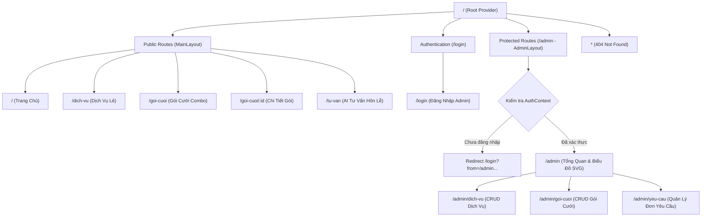

# ĐẶC TẢ HỆ THỐNG ĐỊNH TUYẾN (ROUTING SPECIFICATION - ROUTES.MD)

**Dự án:** Huế Cung Đình – Dịch vụ Cưới & Chụp ảnh (`doan-fenc`)  
**Học phần:** Web FrontEnd Nâng Cao (Mã môn: INT.7.18)  
**Sinh viên thực hiện:** Trần Công Quý (MSSV: 2401ITA001 - Lớp CNTT K22)  
**Giảng viên hướng dẫn:** Thầy Dương Ngọc Duy  
**Thư viện:** React Router v8  
**Quy chuẩn Import:**

- `react-router`: Các Hook (`useNavigate`, `useLocation`, `useParams`, `useSearchParams`), `Outlet`, `Navigate`, `Link`, `NavLink`.
- `react-router/dom`: `createBrowserRouter`, `RouterProvider`.

---

## 1. SƠ ĐỒ ĐỊNH TUYẾN TỔNG THỂ (ROUTING DIAGRAM)



---

## 2. MA TRẬN PHÂN QUYỀN VÀ CÁC TUYẾN ĐƯỜNG (RBAC & ROUTES MATRIX)

Hệ thống thiết lập **Phân Quyền 2 Cấp Độ Tinh Gọn (2-Tier RBAC)**:

- **`admin` (Quản Trị Viên Tối Cao):** Toàn quyền truy cập mọi tính năng quản trị hoàng triều (`/admin`), bao gồm Bảng Điều Hành KPI, Quản Lý Dịch Vụ, Quản Lý Gói Cưới, Bảng Kanban Đơn Yêu Cầu, và Quản Lý Tài Khoản (`/admin/tai-khoan`).
- **`user` / `khach` (Khách Hàng & Khách Vãng Lai):** Truy cập toàn bộ các phân hệ công khai (Landing, Dịch vụ, Gói cưới, Thiệp cưới, Đặt lịch, Giỏ hàng VietQR, AI Tư vấn). Khi người dùng chưa có quyền quản trị cố truy cập `/admin/*`, hệ thống tự động bảo vệ và điều hướng an toàn về `/login`.

| STT | Đường dẫn (Path)      | Tên Component          | Quyền hạn (Access Role) | Layout        | Tính năng chính & Nghiệp vụ nổi bật                                                                                                                                |
| :-: | :-------------------- | :--------------------- | :---------------------: | :------------ | :----------------------------------------------------------------------------------------------------------------------------------------------------------------- |
|  1  | `/`                   | `HomePage`             |   Public (Mọi người)    | `RootLayout`  | Hero banner hoàng gia, Marquee combo chạy liên tục, form tư vấn nhanh                                                                                              |
|  2  | `/dich-vu`            | `ServicesPage`         |   Public (Mọi người)    | `RootLayout`  | Danh mục dịch vụ lẻ, lọc áo dài/thợ ảnh/địa điểm, sắp xếp giá                                                                                                      |
|  3  | `/dich-vu/:id`        | `ServiceDetailPage`    |   Public (Mọi người)    | `RootLayout`  | Chi tiết dịch vụ, hình ảnh độ phân giải cao, đặt lịch lẻ                                                                                                           |
|  4  | `/goi-cuoi`           | `PackagesPage`         |   Public (Mọi người)    | `RootLayout`  | Lưới gói cưới combo hoàng triều, lọc phong cách cung đình/cổ điển                                                                                                  |
|  5  | `/goi-cuoi/:id`       | `PackageDetailPage`    |   Public (Mọi người)    | `RootLayout`  | Chi tiết gói cưới, **In Báo Giá & Dự Thảo Hợp Đồng Hoàng Gia A4 (`window.print()`)**                                                                               |
|  6  | `/thiep-cuoi`         | `InvitationsPage`      |   Public (Mọi người)    | `RootLayout`  | Kho mẫu thiệp cưới điện tử, phong bì mở động, **tích hợp VietQR mừng cưới thông minh**                                                                             |
|  7  | `/thiep-cuoi/dang-ky` | `InvitationCustomPage` |   Public (Mọi người)    | `RootLayout`  | Thiết kế thiệp tùy biến, tải ảnh cô dâu chú rể, nhập thông tin lễ cưới                                                                                             |
|  8  | `/gio-hang`           | `CartPage`             |   Public (Mọi người)    | `RootLayout`  | Giỏ hàng hoàng gia, **đặt cọc giữ ngày cưới 20% qua VietQR động**                                                                                                  |
|  9  | `/don-cua-toi`        | `MyBookingsPage`       |   Public (Mọi người)    | `RootLayout`  | **Lịch sử đơn & Tra cứu tiến độ hôn lễ, hủy yêu cầu (Chuẩn US#4 Mẫu Giảng Viên)**                                                                                  |
| 10  | `/dat-lich`           | `BookingPage`          |   Public (Mọi người)    | `RootLayout`  | Đặt lịch trải nghiệm cổ phục và chụp ảnh tại Đại Nội Huế                                                                                                           |
| 11  | `/tu-van`             | `ConsultationPage`     |   Public (Mọi người)    | `RootLayout`  | AI Tư vấn ngân sách, thuật toán cân đối tài chính hôn lễ cố đô                                                                                                     |
| 12  | `/login`              | `LoginPage`            |   Public (Mọi người)    | `RootLayout`  | Đăng nhập Admin & Khách hàng (có nút quick-fill 2 vai trò)                                                                                                         |
| 13  | `/admin`              | `AdminDashboardPage`   |     **Chỉ `admin`**     | `AdminLayout` | **Dashboard Cao Cấp:** Live Visitor Counter, 4 KPI Sparklines, Bar & Donut SVG tương tác, Time Horizon Switcher, Live Activity Stream & Studio Plan Billing Widget |
| 14  | `/admin/dich-vu`      | `AdminServicesPage`    |     **Chỉ `admin`**     | `AdminLayout` | Quản lý dịch vụ lẻ (Thêm, Sửa, Xóa + ConfirmModal hoàng gia)                                                                                                       |
| 15  | `/admin/goi-cuoi`     | `AdminPackagesPage`    |     **Chỉ `admin`**     | `AdminLayout` | Quản lý gói cưới combo (Multi-select dịch vụ thành phần)                                                                                                           |
| 16  | `/admin/yeu-cau`      | `AdminRequestsPage`    |     **Chỉ `admin`**     | `AdminLayout` | Quản lý đơn tư vấn với **Chế độ xem Bảng + Kanban Board kéo thả tiến độ**                                                                                          |
| 17  | `/admin/tai-khoan`    | `AdminUsersPage`       |     **Chỉ `admin`**     | `AdminLayout` | **Quản lý tài khoản 2 cấp độ: Quản trị viên & Khách hàng**                                                                                                         |
| 18  | `*`                   | `NotFoundPage`         |   Public (Mọi người)    | `RootLayout`  | Trang 404 Cung điện vắng bóng phong cách hoài niệm Huế                                                                                                             |

---

## 3. CHI TIẾT TỪNG TUYẾN ĐƯỜNG (ROUTE DEEP-DIVE)

### 3.1. Tuyến 1: Trang Chủ (`/`)

- **Mô tả:** Giới thiệu thương hiệu "Huế Cung Đình", truyền tải cảm hứng văn hóa và cung cấp lối tắt đến các dịch vụ trọng yếu.
- **Dữ liệu gọi:** `GET /api/goi-cuoi?noiBat=true`, `GET /api/dich-vu?limit=4`.
- **Thành phần UI:**
  - `HeroSection`: Ảnh nền hoàng gia, khẩu hiệu, nút CTA đôi.
  - `CultureIntroSection`: Giới thiệu trang phục Nhật Bình, Áo Tấc, nghi thức nghinh hôn.
  - `FeaturedPackagesSection`: Danh sách 3 gói cưới hot nhất.
  - `QuickConsultForm`: Biểu mẫu nhập thông tin nhanh (tên, số điện thoại, ngày cưới).
- **Kiểm thực:** Zod Schema cho Quick Consultation Form.

---

### 3.2. Tuyến 2: Danh Sách Dịch Vụ Lẻ (`/dich-vu`)

- **Mô tả:** Nơi khách hàng duyệt qua các hạng mục đơn lẻ để tham khảo hoặc tùy biến nhu cầu.
- **Tham số URL (Query Params):**
  - `loai`: `all | ao-dai | tho-anh | dia-diem | trang-tri` (Mặc định: `all`).
  - `sort`: `price-asc | price-desc | name-asc` (Mặc định: `price-asc`).
- **Kiểm thực Query:** Sử dụng Zod để parse và fallback về giá trị mặc định an toàn nếu query sai lệch.
- **Trạng thái Async:** `AsyncState<DichVu[]>` kết hợp Skeleton Loading khi đang fetch dữ liệu.

---

### 3.3. Tuyến 3: Danh Sách Gói Cưới Combo (`/goi-cuoi`)

- **Mô tả:** Hiển thị các gói cưới trọn gói với mức giá ưu đãi hấp dẫn so với đặt lẻ.
- **Bộ lọc phong cách:** `all | cung-dinh | hien-dai | co-dien`.
- **Dữ liệu gọi:** `GET /api/goi-cuoi`.
- **Thẻ gói cưới (PackageCard):** Hiển thị nhãn phong cách, giá trọn gói, số lượng dịch vụ bao gồm, nút "Xem Chi Tiết".

---

### 3.4. Tuyến 4: Chi Tiết Gói Cưới (`/goi-cuoi/:id`)

- **Mô tả:** Tuyến đường động hiển thị thông tin chuyên sâu của một gói cưới.
- **Tham số Param:** `:id` (kiểm thực chuỗi ký tự không rỗng bằng Zod).
- **Dữ liệu gọi:** `GET /api/goi-cuoi/:id` và `GET /api/dich-vu` (để map tên và đơn giá của các dịch vụ trong mảng `danhSachDichVuIds`).
- **Chức năng Giỏ Hàng:**
  - Nút "Thêm vào giỏ cưới": Ghi nhận gói vào Zustand `cartStore`.
  - Hiển thị Toast thông báo thành công ở góc màn hình.
  - Tự động lưu trữ qua middleware `persist` của Zustand vào `localStorage`.

---

### 3.5. Tuyến 5: AI Tư Vấn Hôn Lễ Hoàng Triều (`/tu-van`)

- **Mô tả:** Công cụ thông minh hỗ trợ khách hàng lập dự toán tài chính và tìm gói cưới hoàn hảo.
- **Dữ liệu nhập vào:**
  - `nganSach`: Số tiền dự trù (VND, tối thiểu 10.000.000 đ).
  - `soLuongKhach`: Quy mô khách mời (người).
  - `phongCach`: Phong cách hôn lễ ưu tiên.
- **Dữ liệu gọi:** `POST /api/tu-van/tinh-toan` (gửi body JSON, nhận kết quả phân tích).
- **Phản hồi thuật toán:**
  - `goiDeXuat`: Thông tin gói cưới phù hợp nhất.
  - `chenhLech`: Số tiền thừa hoặc số tiền còn thiếu.
  - `dichVuGoiYThem`: Danh sách dịch vụ lẻ có thể bổ sung nếu ngân sách còn dư.
  - Nút "Chuyển thành Đơn Yêu Cầu" để gửi trực tiếp thông tin vào hệ thống quản trị.

---

### 3.6. Tuyến 6: Đăng Nhập Quản Trị (`/login`)

- **Mô tả:** Cổng xác thực dành riêng cho Admin.
- **Biểu mẫu:** Username & Password.
- **Cơ chế xác thực:**
  - Kiểm tra tài khoản `admin` / `123456`.
  - Cập nhật state trong `AuthContext`.
  - Chuyển hướng người dùng về trang họ đang cố truy cập trước đó (`location.state.from`) hoặc mặc định về `/admin`.

---

### 3.7. Tuyến 7: Admin Dashboard Hoàng Gia & SaaS Analytics (`/admin`)

- **Mô tả:** Trung tâm điều hành kinh doanh trực quan với các chỉ số tài chính thời gian thực và trải nghiệm SaaS hiện đại (lấy cảm hứng từ Corbel Dashboard).
- **Bảo vệ:** `ProtectedRoute allowedRoles={["admin", "nhan-vien"]}`.
- **Dữ liệu gọi:** `GET /api/admin/thong-ke` và `GET /api/yeu-cau`.
- **Thành phần phân tích & Tiện ích thông minh:**
  - **Live Visitor Counter:** Đèn xung nhịp nhấp nháy xanh ngọc và bộ đếm số lượng khách đang xem website thời gian thực (15-28 khách).
  - **Smart Greeter & Quick Action Bar:** Lời chào theo buổi trong ngày và cụm nút thao tác nhanh (+ Thêm dịch vụ, + Đóng gói cưới, 📋 Kanban, 🖨️ In báo cáo).
  - **Time Horizon Switcher:** 4 bộ lọc thời gian: Hôm Nay, 7 Ngày Qua, Tháng Này, Cả Năm 2026.
  - **4 Thẻ KPI Tích Hợp Pure SVG Sparklines:** Doanh thu (+18.5%), Tổng hợp đồng cưới (+12.5%), Đơn chờ xử lý (-15%), Tỷ lệ chốt thành công (92%), kèm thanh đo mục tiêu tháng (82%).
  - **Biểu đồ Cột Doanh Thu SVG:** Cột kép so sánh baseline cùng kỳ, hiệu ứng hover tooltip chi tiết số tiền và tăng trưởng.
  - **Biểu đồ Donut SVG:** Tâm hiển thị tổng 48 hợp đồng, chú giải kèm thanh tiến độ mini % đóng góp doanh thu của từng gói cưới.
  - **Dòng Nhật Ký Hoạt Động (Live Stream) & Bảng Xếp Hạng Top Bán Chạy:** Cập nhật các sự kiện khách cọc, duyệt đơn theo thời gian tương đối.
  - **Widget Bản Quyền Studio Enterprise & Tải Hóa Đơn:** Hiển thị thời hạn bản quyền VIP và cho phép tải hóa đơn `INV-2026-1024P.txt` về máy.

---

### 3.8. Tuyến 8: Quản Lý Dịch Vụ Lẻ (`/admin/dich-vu`)

- **Mô tả:** Bảng quản trị danh mục dịch vụ.
- **Chức năng:**
  - Bảng dữ liệu có ảnh thumbnail, tên, loại, đơn giá và hành động.
  - Modal Thêm / Chỉnh sửa dịch vụ với Zod validation.
  - Modal Xác nhận Xóa (`ConfirmModal`): Bắt buộc người dùng nhấn "Xác nhận xóa" mới gọi API `DELETE /api/dich-vu/:id`.

---

### 3.9. Tuyến 9: Quản Lý Gói Cưới Combo (`/admin/goi-cuoi`)

- **Mô tả:** Đóng gói và thiết lập các gói cưới combo.
- **Chức năng đặc thù:**
  - Form tạo/sửa gói tích hợp tính năng **chọn nhiều dịch vụ lẻ (Multi-checkbox)**.
  - Tự động hiển thị tổng giá trị gốc của các dịch vụ được chọn để Admin cân đối định mức giá trọn gói ưu đãi.

---

### 3.10. Tuyến 10: Quản Lý Đơn Yêu Cầu (`/admin/yeu-cau`)

- **Mô tả:** Tiếp nhận và chăm sóc các đơn đăng ký của khách hàng.
- **Chức năng:**
  - Phân loại tab: Tất cả, Chờ xử lý (`cho-xu-ly`), Đã liên hệ (`da-lien-he`), Hoàn thành (`hoan-thanh`).
  - Nút chuyển trạng thái nhanh (1 click cập nhật `PATCH /api/yeu-cau/:id`).
  - Xem chi tiết thông tin liên hệ và ghi chú của khách hàng.

---

### 3.11. Tuyến 11: Trang 404 Không Tìm Thấy (`*`)

- **Mô tả:** Bắt mọi URL không tồn tại trong hệ thống.
- **Giao diện:** Thông báo "Cung Điện Vắng Bóng - Đường Đi Không Tồn Tại", nút điều hướng quay về trang chủ.

---

## 4. BẢO MẬT & ĐIỀU HƯỚNG BẢO VỆ (PROTECTED ROUTE IMPLEMENTATION)

```typescript
// src/features/auth/ProtectedRoute.tsx
import { ReactNode } from "react";
import { Navigate, useLocation } from "react-router";
import { useAuth } from "./AuthContext";

interface ProtectedRouteProps {
  children: ReactNode;
}

export function ProtectedRoute({ children }: ProtectedRouteProps) {
  const { isAuthenticated } = useAuth();
  const location = useLocation();

  if (!isAuthenticated) {
    return <Navigate to="/login" state={{ from: location }} replace />;
  }

  return <>{children}</>;
}
```

Mô hình đảm bảo khi người dùng gõ trực tiếp URL `/admin/...` trên thanh địa chỉ, hệ thống lập tức chuyển hướng an toàn và khôi phục đúng đường dẫn sau khi đăng nhập thành công.

mSLlbK97i0CpUJoU
